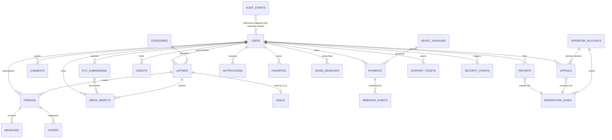

# Database Design — Trust Bazar

**Version:** 2.0
**Date:** 2026-11-13
**Based on:** [dfd.md](dfd.md) v1.1 (Data Dictionary/Store Table) · [Architecture.md](Architecture.md) v1.1 §5 · [PRD.md](PRD.md) v1.7.1
**Changelog v1.1:** fixed compound TTL index (MongoDB requires single-field) · removed `optimisticConcurrency` conflict with custom `version` · `location.district` index path corrected · §7.2 session init added · ERD SAVED_SEARCHES added
**Changelog v1.2 (final cross-doc audit):** aligned to PRD Appx C — title 10–100, description 20–5000, price max 99,999,999, condition enum (refurbished/forParts), photos 1–10, displayName ≤50 · offers: `listingId` denormalized + partial-unique one-pending index · deal undo window corrected to 15 min (PRD §3.3.6) · sample data undoUntil fixed
**Changelog v1.3 (standalone audit):** §7.1 transaction code `plus24h()` → `plus15min()` (matched the v1.2 rule) · §6.1 cross-ref PRD §8 → §1.5 · `moderationCases.status` field added (used by §7.2) · sample user `dobEnc` added
**Changelog v1.4:** Redis BullMQ queue list expanded to match Architecture §7 (12 queues; was 4 with inconsistent naming)
**Changelog v1.5:** cross-doc enum alignment — threads.state unified to 7 values (was `active|soldBanner|frozen`) · added missing `threadSchema` Mongoose model (was absent from §9) · listings.boost added `pausedAt`/`remainingMs` (suspension pause, §3.3.9/§3.6) — all aligned with database_schema.md v1.3
**Changelog v1.6 (PROMPT 04 implementation):** `webhookEvents` → `gateway/eventId/payload/receivedAt` + unique `{gateway,eventId}` dedupe · `idempotencyKeys` `_id` IS the client key (unique index removed as redundant) · `auditEvents` gains `seq` + `at` (was `ts`) + `actor` enum · `config._id` is the key (dropped duplicate `key`) · `operatorAccounts.role` → `kycReviewer|moderator|senior` (PRD §4 US-OP) · `notifications`/`reports`/`appeals`/`supportTickets`/`savedSearches`/`mediaObjects` field names aligned to the implemented models · `kycSubmissions` TTL is partial on `status:"rejected"` (a null `expiresAt` would otherwise purge immediately)
**Changelog v1.7 (PROMPT 05 implementation):** `users.sessions` subdoc aligned to the code — `id`/`deviceIdHash`/`refreshTokenHash`/`issuedAt`/`expiresAt`/`lastUsedAt` (was `deviceFp`/`refreshHash`/`lastUsed`/`createdAt`); rotation writes a new hash and `$slice:-3` evicts the oldest on the 4th login · `securityEvents` uses `at` (not `createdAt`) and its index is `{userId, at:-1}` · security event types gained `bruteForce` + `phoneChange` (phone change keeps `nidHash` untouched)
**Changelog v1.8 (PROMPT 07–10 implementation):** `categories._id` is a deterministic ObjectId (`sha256(slug)[0:24]`) so `listings.categoryId` (ObjectId) can reference the seeded taxonomy; `parentId` is an ObjectId and `slug` is unique · `kycSubmissions.mediaIds` = NID front/back (+ selfie only for `sellerFull`), reason enum gains `DUPLICATE_NID`, `consentVersion` is `v1`/`recovery-v1` · `mediaObjects` gains `contentType`/`scanProvider`/`scanReason` · new indexes `listings.pHashes`, `categories.uq_categories_slug`, `categories.idx_categories_parent`
**Changelog v1.9 (PROMPT 11 implementation):** `messages.readAt` is the recipient read marker powering 1:1 unread counts (sender's own messages are excluded) · `offers.counterAmount` stores the seller's counter when `status:"countered"`, and the validator enum is aligned to `pending|accepted|declined|countered|expired` · `moderationCases.snapshot` freezes the last 100 messages for report-based cases · message pagination uses the monotonic `_id` as the `before` cursor while `messages {threadId, createdAt}` remains the range index
**Changelog v2.0 (PROMPT 13–16 implementation):** `payments.packageId` is a **string** (`boost-3d`/`boost-7d`/`boost-15d`) matching the `boostPackages` catalog, and the payments validator now accepts string ids plus `double` amounts; payments gain `listingId`, `gatewayUrl`, `failureReason`, `paidAt`, `gatewayRefs` and a **unique-sparse `receiptNo`** (issued on success only) · `listings.boost.packageId` is likewise a string · `notifications` gains `dedupeKey` (**unique sparse** = the single idempotency primitive), `count`/`lastAt` (chat coalescing) and the `ops` channel · `supportTickets` stores embedded `messages[]` (`authorType`/`authorId`/`body`/`at`) + `lastReplyAt`, replacing the single-body shape · `operatorAccounts.role` → `kycReviewer|moderator|seniorModerator|superadmin` · `kycSubmissions` gains `claimedBy`/`lockUntil` (5-min queue claim) and `purgedAt`; `moderationCases` gains `pendingBan` + `banApprovals[]` (4-eyes) · `users.pushTokens[]` (`fcm`/`apns`) · new indexes: `payments {listingId}`, `payments.receiptNo` unique sparse, `notifications.dedupeKey` unique sparse, `kycSubmissions {claimedBy, lockUntil}`, `supportTickets {userId, createdAt:-1}` · `auditEvents.hash` is computed in a **pre-validate** hook so the required field is populated before Mongoose validation
**Engine:** MongoDB Atlas (app cluster) + separate audit cluster + Redis (ephemeral)

---

## 1. Collection List

| # | Collection | Cluster | Purpose | DFD Store |
|---|---|---|---|---|
| 1 | `users` | App | Identity, encrypted PII, roles, sessions, enforcement | D1 |
| 2 | `kycSubmissions` | App | Verification attempts + state machine | D2 |
| 3 | `consents` | App | Versioned consent records (NFR-05) | D2 |
| 4 | `listings` | App | Ads, boost state, lifecycle | D3 |
| 5 | `boostPackages` | App | Server-managed boost catalog | D3 |
| 6 | `threads` | App | Chat threads (listing-scoped) | D4 |
| 7 | `messages` | App | Chat messages | D4 |
| 8 | `offers` | App | Price offers (48h TTL state machine) | D4 |
| 9 | `deals` | App | Confirmed / Direct / Unconfirmed sales | D5 |
| 10 | `payments` | App | Boost payment state machine | D6 |
| 11 | `webhookEvents` | App | Raw gateway callback archive | D6 |
| 12 | `idempotencyKeys` | App | API idempotency registry | D6 |
| 13 | `credits` | App | Boost credit ledger | D6 |
| 14 | `reports` | App | User reports (listing/user/message) | D7 |
| 15 | `moderationCases` | App | Ops queue items, claim-locks, SLA | D7 |
| 16 | `appeals` | App | Appeals against enforcement/KYC | D7 |
| 17 | `supportTickets` | App | Contact-support tickets | D7 |
| 18 | `notifications` | App | Durable in-app notification records | D8 |
| 19 | `favorites` | App | Saved listings | D8 |
| 20 | `savedSearches` | App | Saved searches + alert prefs | D8 |
| 21 | `mediaObjects` | App | Upload tracking (R2 keys, scan status, pHash) | D10 ref |
| 22 | `categories` | App | Seeded taxonomy + district list + price baselines | config |
| 23 | `securityEvents` | App | Login alerts, step-up, refresh-reuse | D12 ref |
| 24 | `operatorAccounts` | App | Ops staff, roles, 2FA, IP allowlist | — |
| 25 | `config` | App | Feature flags, geo launch, min client version | — |
| 26 | `auditEvents` | **Audit cluster** | Append-only hash-chained ops log | D12 |

**Redis (not collections):** `otp:{phone}` (TTL 5m), `rl:{bucket}:{id}` (rate limits), `sess:lock:{userId}`, BullMQ queues (per Architecture §7: `recon`, `expiry-reminders`, `offer-expiry`, `lifecycle`, `purge`, `sla-scan`, `ai-scan`, `media-pipeline`, `audit-verify`, `webhook-drain`, `saved-search-alerts`, `breach-notify`), `socket:presence:{userId}`.

---

## 2. Schema (field-level)

### 2.1 `users`
| Field | Type | Notes |
|---|---|---|
| _id | ObjectId | |
| phone | string | E.164 `+8801XXXXXXXXX`, unique, masked in logs |
| nidHash | string | HMAC-SHA256(nid, pepper) — **unique, sparse**; identity anchor |
| nidEnc / nameEnc / dobEnc | string | AES-256-GCM ciphertext (key via KMS) |
| roles | string[] | subset of `["buyer","verifiedBuyer","seller"]` |
| enforcement | { state: `"none"\|"warned"\|"suspended"\|"banned"`, until?: Date, reasonCode?: string, history: subdoc[] } | |
| sessions | subdoc[] (max 3) | { id: uuid, deviceIdHash: sha256(deviceFp), platform: `"web"\|"android"\|"ios"`, refreshTokenHash: sha256(jwt), issuedAt, expiresAt, lastUsedAt } — oldest evicted by `$slice:-3` |
| profile | { displayName, photoMediaId?, memberSince, sellerStats: { activeListings, confirmedDeals, disputes90d } } | displayName moderated |
| notificationPrefs | { push: bool, sms: bool, digest: bool, lang: `"bn"\|"en"` } | |
| deletedAt / purgeAt | Date | 14-day grace scheduling |
| createdAt / updatedAt | Date | |

### 2.2 `kycSubmissions`
| Field | Type | Notes |
|---|---|---|
| _id | ObjectId | |
| userId | ObjectId → users | |
| type | `"buyerNID" \| "sellerFull"` | |
| status | `"pending" \| "pending-vendor" \| "approved" \| "rejected"` | pending-vendor = Porichoy degraded |
| porichoyTxnId | string | vendor transaction ref |
| mediaIds | ObjectId[] → mediaObjects | NID front/back (+ selfie for `sellerFull`); buyer NID has no selfie |
| attemptCount | int | max 3 per 30 days |
| consentVersion | string | → consents (`v1`; `recovery-v1` for SIM recovery) |
| reviewerId / reviewedAt / reasonCode | — | claim-locked review; reason enum includes `DUPLICATE_NID` |
| claimedBy / lockUntil | ObjectId / Date | ops queue claim lock — 5 min, expired locks are reclaimable |
| media | { frontId, backId, selfieId?, livenessId? } | NID front/back (+ selfie/liveness for `sellerFull`) |
| purgedAt | Date \| null | purge job removes `media` after the retention window |
| expiresAt | Date | rejected → +90 days (purge driver) |
| createdAt | Date | |

### 2.3 `listings`
| Field | Type | Notes |
|---|---|---|
| _id | ObjectId | |
| sellerId | ObjectId → users | |
| title / description | string | 10–100 / 20–5000 chars (PRD Appx C) |
| price | int (BDT) | 1 – 99,999,999 (PRD Appx C) |
| condition | `"new" \| "likeNew" \| "good" \| "refurbished" \| "forParts"` | PRD Appx C enum |
| categoryId | ObjectId → categories | |
| location | { district: string, geo: { type:"Point", coordinates:[lng,lat] } } | |
| mediaIds | ObjectId[] → mediaObjects | 1–10 (PRD §3.3.2), first = hero |
| pHashes | string[] | perceptual hashes (duplicate detection) |
| status | `"draft" \| "active" \| "pendingConfirm" \| "sold" \| "expired" \| "delisted" \| "archived"` | |
| boost | { active: bool, until?: Date, packageId?: **string** (`boost-3d`), pausedAt?: Date, remainingMs?: number } | paused on 7-day suspension (§3.3.9/§3.6); resumed with `until = now + remainingMs` |
| stats | { views, chatStarts, callTaps, favorites } | counters |
| version | int | optimistic locking |
| expiresAt | Date | now+30d on publish/renew; drafts TTL purge |
| aiScan | { status: `"queued"\|"clean"\|"flagged"`, flags: string[] } | async |
| createdAt / updatedAt | Date | |

### 2.4 `threads`
| Field | Type | Notes |
|---|---|---|
| _id | ObjectId | |
| listingId | ObjectId → listings | |
| buyerId / sellerId | ObjectId → users | |
| state | `"active" \| "soldBanner" \| "buyerBlocked" \| "sellerBlocked" \| "deletedListing" \| "archived" \| "frozen"` | frozen = ban/suspension; soldBanner = deal confirmed |
| buyerMsgCount | int | anti-gaming check input |
| lastMessageAt | Date | |
| createdAt | Date | **unique (listingId, buyerId)** |

### 2.5 `messages`
| Field | Type | Notes |
|---|---|---|
| _id | ObjectId | |
| threadId | ObjectId → threads | |
| senderId | ObjectId → users | |
| clientMsgId | string | idempotency — **unique (threadId, clientMsgId)** |
| body | string | 1–2000 chars |
| flags | string[] | `offPlatformWarn`, `urlWarn` |
| createdAt | Date | |

### 2.6 `offers`
| Field | Type | Notes |
|---|---|---|
| _id | ObjectId | |
| threadId / buyerId / listingId | refs | listingId denormalized (one-pending-offer index) |
| amount | int | ≤ listing price × 2 |
| status | `"pending" \| "accepted" \| "declined" \| "countered" \| "expired"` | monotonic |
| expiresAt | Date | createdAt + 48h (TTL scan) |
| createdAt | Date | |

### 2.7 `deals`
| Field | Type | Notes |
|---|---|---|
| _id | ObjectId | |
| listingId | ObjectId → listings | unique (one deal per listing) |
| sellerId | ObjectId → users | |
| buyerId | ObjectId → users \| null | null = Direct Sale |
| type | `"confirmed" \| "direct" \| "unconfirmed"` | |
| confirmedAt | Date \| null | |
| disputeRef | ObjectId → moderationCases \| null | buyer declined confirmation |
| undoUntil | Date \| null | 15-min undo window, void after buyer response (PRD §3.3.6/§5.5) |
| createdAt | Date | **immutable after confirm** |

### 2.8 `payments`
| Field | Type | Notes |
|---|---|---|
| _id | ObjectId | |
| userId | ObjectId → users | |
| packageId | **string** → boostPackages (`boost-3d`/`boost-7d`/`boost-15d`) | price resolved server-side |
| listingId | ObjectId → listings | the boosted ad |
| amount / currency | number / `"BDT"` | `amount = priceBdt − creditApplied` (0 → auto-complete) |
| provider | `"bkash" \| "nagad"` | |
| state | `"initiated" \| "pending" \| "success" \| "failed" \| "expired"` | monotonic, forward-only |
| idempotencyKey | string | **unique** |
| creditApplied | int | credits applied FIFO at checkout |
| gatewayUrl | string \| null | provider checkout URL |
| gatewayRefs | { paymentId, trxId?, webhookEventIds[] } | vendor refs |
| failureReason | string \| null | gateway failure code |
| paidAt | Date \| null | receipt window anchor (12 months) |
| receiptNo | string \| null | `TB-YYYY-NNNNNN`, **unique sparse** — issued on success only |
| createdAt / updatedAt | Date | |

### 2.9 Other collections (compact)

| Collection | Key fields |
|---|---|
| `webhookEvents` | gateway, eventId, signatureOk, payload (raw obj), paymentId?, receivedAt, processedAt, processError — unique (`gateway`, `eventId`) = duplicate delivery no-op |
| `idempotencyKeys` | **`_id` = the client Idempotency-Key** (unique by design), userId?, endpoint?, payloadHash, status, body, expiresAt (TTL 24h) |
| `credits` | userId, amount, source (`goodwill`\|`reconciliation`\|`appeal`\|`refund`), reason?, remaining, expiresAt (issued +12m) — FIFO consumption by `expiresAt` |
| `boostPackages` | **`_id` = string** (`boost-3d`\|`boost-7d`\|`boost-15d`), name, durationDays (3/7/15), priceBdt, placement, active — server-managed, no client trust |
| `reports` | reporterId, targetType (`listing`\|`user`\|`message`), targetId, category, details ≤1000, status; one open report per reporter+target, 5/24h cap |
| `moderationCases` | source (`report`\|`ai`\|`dispute`\|`appeal`), refId (**reported targetId** for report cases), status (`open`\|`claimed`\|`closed`), claimedBy, lockUntil (5m), slaDue (+48h), action, reasonCode, snapshot, pendingBan { proposedBy, reasonCode, proposedAt }, banApprovals[] |
| `appeals` | userId, caseId?, referenceId, type (`kyc`\|`enforcement`\|`delisting`), body ≤2000, status, outcome (`uphold`\|`reverse`), resolvedBy (senior, ≠ original actor), resolvedAt, slaDue (24h suspended / 72h otherwise) |
| `supportTickets` | userId, category, subject ≤120, body ≤1000, attachmentMediaId?, messages[] { authorType (`user`\|`operator`), authorId, body, at }, lastReplyAt, status (`open`\|`pending`\|`resolved`\|`closed`), slaDue (48h) |
| `notifications` | userId, type, payload, channels (`inApp`\|`push`\|`sms`\|`ops`), status, readAt, **dedupeKey** (unique sparse), count, lastAt — durable + delivery; quiet hours 22:00–08:00 Asia/Dhaka |
| `favorites` | userId, listingId, createdAt — unique pair |
| `savedSearches` | userId, query, filters, frequency (`instant`\|`daily`), lastNotifiedAt |
| `mediaObjects` | ownerId, purpose (`kyc`\|`listing`\|`profile`), r2Key, status (`uploaded`\|`scanning`\|`clean`\|`quarantined`), pHash?, sizeBytes, contentType?, scanProvider?, scanReason? |
| `categories` | **`_id` = deterministic ObjectId(sha256(slug)[0:24])**, name (bn/en), slug (unique), parentId? (ObjectId, null at root), priceBaseline: { p25, p50, p75 } (seeded manually, insert-only), districts: string[] |
| `securityEvents` | userId, type (`newDevice`\|`stepUp`\|`refreshReuse`\|`bruteForce`\|`recovery`\|`phoneChange`), meta (deviceFp/ip/sessionId — masked PII), at |
| `operatorAccounts` | email (unique), role (`kycReviewer`\|`moderator`\|`seniorModerator`\|`superadmin`), totpSecretEnc (base32), ipAllowlist[], active — operator JWT 15 min, TOTP ±1 step |
| `config` | **`_id` = key** (`featureFlags`\|`geoLaunch`\|`minVersion`\|`consentVersion`\|`opsInbox` { userId }), value (obj), updatedBy — `PUT /ops/config` audits before/after and busts the 60-s cache |
| `auditEvents` (audit cluster) | seq (unique), actor (`user`\|`operator`\|`system`), actorId, action, entityType, entityId, before/after, prevHash, hash = sha256(prevHash+canonical(doc)), at — **append-only DB user** |

---

## 3. Relationships

**Ownership (1:N via reference):** users→kycSubmissions · users→listings · users→payments · users→credits · users→threads (as buyer or seller) · users→notifications · users→favorites/savedSearches · users→reports · operatorAccounts→moderationCases/appeals (as claimedBy/reviewerId).

**Embedded (read-together, no joins):** sessions[] and enforcement inside users · boost + stats + aiScan inside listings · location.geo inside listings.

**Cross-references resolved at service layer:** listings.mediaIds[] → mediaObjects · kycSubmissions.mediaIds[] → mediaObjects · deals.listingId (1:1 unique) · payments.packageId → boostPackages · moderationCases.refId → polymorphic (report/listing/user).

**No DB-level cascades** — deletion flows are job-driven (purge worker per NFR-05 retention).

---

## 4. Indexes

| Collection | Indexes |
|---|---|
| users | `phone` unique · `nidHash` unique sparse · `purgeAt` (partial: deletedAt exists) |
| kycSubmissions | `{userId, createdAt}` · `{status, createdAt}` (review queue) · `{claimedBy, lockUntil}` (ops claim) · `expiresAt` **TTL partial (single-field)** where `status:"rejected"` |
| listings | `{sellerId, status}` · `{categoryId, status, createdAt:-1}` · `{location.district, status, price}` · `location.geo` 2dsphere · `expiresAt` · **TTL partial (single-field)**: `expiresAt` where `status:"draft"` · `boost.until` (demote job) · `pHashes` (duplicate-image warning) |
| threads | `{listingId, buyerId}` unique · `{buyerId, lastMessageAt:-1}` · `{sellerId, lastMessageAt:-1}` |
| messages | `{threadId, createdAt}` · `{threadId, clientMsgId}` unique |
| offers | `{threadId, status}` · `expiresAt` · **partial unique** `{buyerId, listingId}` where `status:"pending"` (one active offer per buyer per listing, PRD §3.3.7) |
| deals | `listingId` unique · `{sellerId, type}` · `{buyerId, createdAt:-1}` |
| payments | `idempotencyKey` unique · `{userId, createdAt:-1}` · `{state, updatedAt}` (recon) · `{listingId}` · `receiptNo` **unique sparse** |
| webhookEvents | **`{gateway, eventId}` unique** (duplicate-delivery no-op) · `{gateway, processedAt}` · `paymentId` |
| idempotencyKeys | **`_id` = client key** (no extra index) · `expiresAt` TTL |
| credits | `{userId, expiresAt}` · `expiresAt` |
| reports | `{targetType, targetId}` · `{status, createdAt}` |
| moderationCases | `{claimedBy, lockUntil}` · `slaDue` |
| appeals | `{userId}` · `slaDue` |
| notifications | `{userId, readAt}` · `{userId, createdAt:-1}` · `dedupeKey` **unique sparse** |
| favorites | `{userId, listingId}` unique |
| mediaObjects | `ownerId` · `{status, createdAt}` (scan queue) · `pHash` |
| categories | `slug` unique · `parentId` (leaf lookup) |
| savedSearches | `{userId, createdAt:-1}` |
| supportTickets | `{status, slaDue}` (SLA scan) · `{userId, createdAt:-1}` (my tickets) |
| operatorAccounts | `email` unique |
| securityEvents | `{userId, at:-1}` |
| auditEvents | `seq` unique · `{entityType, entityId, at}` · `{actorId, at}` |
| Atlas Search | `listings_search`: title/description autocomplete, bn/en keyword, filters (category, district, price, condition) — **Bangla quality = POC gate (Arch §10#4)** |

---

## 5. Validation

**Two layers:** (1) API-layer **zod schemas** = PRD Appendix C rules (primary, shared package); (2) MongoDB `$jsonSchema` validators = last-line defense on core collections.

Example — `listings` validator:

```javascript
db.createCollection("listings", {
  validator: {
    $jsonSchema: {
      bsonType: "object",
      required: ["sellerId", "title", "description", "price", "condition",
                 "categoryId", "location", "mediaIds", "status", "version"],
      properties: {
        title:       { bsonType: "string", minLength: 10, maxLength: 100 },
        description: { bsonType: "string", minLength: 20, maxLength: 5000 },
        price:       { bsonType: "int", minimum: 1, maximum: 99999999 },
        condition:   { enum: ["new", "likeNew", "good", "refurbished", "forParts"] },
        status:      { enum: ["draft", "active", "pendingConfirm", "sold",
                              "expired", "delisted", "archived"] },
        mediaIds:    { bsonType: "array", minItems: 1, maxItems: 10 },
        version:     { bsonType: "int", minimum: 0 }
      }
    }
  },
  validationLevel: "strict",
  validationAction: "error"
});
```

Same pattern applies to: `users` (phone regex `^\+8801[3-9]\d{8}$`, roles enum, sessions maxItems 3) · `payments` (state enum, gateway enum) · `offers` (status enum, amount ≥ 1) · `messages` (body 1–2000) · `reports` (targetType/category enums, comment ≤ 1000). **State-machine monotonicity is enforced in service code, not validators** (validators can't compare old vs new).

---

## 6. Aggregation Pipelines (key use cases)

**6.1 Fraud-rate KPI (monthly, Confirmed Deals only — PRD §1.5):**
```javascript
db.deals.aggregate([
  { $match: { type: "confirmed", confirmedAt: { $gte: monthStart } } },
  { $lookup: { from: "moderationCases", localField: "disputeRef",
               foreignField: "_id", as: "disputes" } },
  { $group: { _id: null,
      total: { $sum: 1 },
      fraud: { $sum: { $cond: [{ $gt: [{ $size: "$disputes" }, 0] }, 1, 0] } } },
  { $project: { fraudRatePct: { $multiply: [{ $divide: ["$fraud", "$total"] }, 100] } } }
]);
```

**6.2 Trending listings (24h engagement):**
```javascript
db.listings.aggregate([
  { $match: { status: "active", updatedAt: { $gte: since24h } } },
  { $project: { title: 1, price: 1, mediaIds: { $slice: ["$mediaIds", 1] },
      score: { $add: ["$stats.views",
               { $multiply: ["$stats.chatStarts", 5] },
               { $multiply: ["$stats.callTaps", 3] },
               { $multiply: ["$stats.favorites", 2] }] } } },
  { $sort: { score: -1 } }, { $limit: 20 }
]);
```

**6.3 KYC queue SLA monitor:**
```javascript
db.kycSubmissions.aggregate([
  { $match: { status: { $in: ["pending", "pending-vendor"] } } },
  { $project: { ageHours: { $divide: [{ $subtract: ["$$NOW", "$createdAt"] }, 36e5] } } },
  { $group: { _id: "$status", count: { $sum: 1 },
      breaching24h: { $sum: { $cond: [{ $gte: ["$ageHours", 24] }, 1, 0] } } } }
]);
```

**6.4 Boost revenue summary (by package, by month):**
```javascript
db.payments.aggregate([
  { $match: { state: "success", createdAt: { $gte: monthStart } } },
  { $group: { _id: "$packageId", revenue: { $sum: "$amount" },
      count: { $sum: 1 }, creditsUsed: { $sum: "$creditApplied" } } },
  { $lookup: { from: "boostPackages", localField: "_id",
               foreignField: "_id", as: "pkg" } }
]);
```

---

## 7. Transactions

Multi-document writes use **replica-set transactions** (Atlas M10+ supports). Two required cases:

**7.1 Deal confirmation (atomic across 3 collections):**
```javascript
const session = await mongoose.startSession();
await session.withTransaction(async () => {
  await Listing.updateOne(
    { _id: listingId, status: "pendingConfirm", version: expectedVersion },
    { $set: { status: "sold" }, $inc: { version: 1 } }, { session });
  await Deal.create([{ listingId, sellerId, buyerId, type: "confirmed",
    confirmedAt: new Date(), undoUntil: plus15min() }], { session });
  // undoUntil = mark-sold time + 15 min (PRD §3.3.6); void once buyer responds
  await Thread.updateOne({ _id: threadId },
    { $set: { state: "soldBanner" } }, { session });
});
// any failure → full rollback; no half-sold state
```

**7.2 Ban enforcement (user + all listings + case close):**
```javascript
const session = await mongoose.startSession();
await session.withTransaction(async () => {
  await User.updateOne({ _id: userId },
    { $set: { "enforcement.state": "banned" } }, { session });
  await Listing.updateMany({ sellerId: userId, status: "active" },
    { $set: { status: "delisted" } }, { session });
  await ModerationCase.updateOne({ _id: caseId },
    { $set: { action: "ban", status: "closed" } }, { session });
});
// auditEvents written AFTER commit (append-only, separate cluster — never in tx)
```

Everything else is **single-document atomic** by design (payment state transitions, message inserts with unique clientMsgId, idempotency claims) — no transaction needed.

---

## 8. Sample Data

**users (verified seller):**
```json
{
  "_id": "66f1a2b3c4d5e6f708192a01",
  "phone": "+8801712345678",
  "nidHash": "9b2e...hmac",
  "nidEnc": "aes256gcm:iv:ct:tag",
  "nameEnc": "aes256gcm:iv:ct:tag",
  "dobEnc": "aes256gcm:iv:ct:tag",
  "roles": ["buyer", "verifiedBuyer", "seller"],
  "enforcement": { "state": "none", "history": [] },
  "sessions": [{ "id": "8f0c...-uuid", "deviceIdHash": "sha256:...", "refreshTokenHash": "sha256:...",
                 "platform": "android", "issuedAt": "2026-10-17T09:00:00Z",
                 "expiresAt": "2026-11-16T09:00:00Z", "lastUsedAt": "2026-10-17T09:00:00Z" }],
  "profile": { "displayName": "Rahim Uddin", "memberSince": "2026-10-01T00:00:00Z",
               "sellerStats": { "activeListings": 2, "confirmedDeals": 5, "disputes90d": 0 } },
  "notificationPrefs": { "push": true, "sms": true, "digest": false, "lang": "bn" },
  "createdAt": "2026-10-01T10:00:00Z"
}
```

**listings (active, boosted):**
```json
{
  "_id": "66f1b2c3d4e5f60718293b02",
  "sellerId": "66f1a2b3c4d5e6f708192a01",
  "title": "iPhone 13 128GB — full box, battery 89%",
  "description": "18 months used, no scratch, charger+cable included...",
  "price": 52000, "condition": "good",
  "categoryId": "66f0c1d2e3f4051627384c03",
  "location": { "district": "Dhaka",
    "geo": { "type": "Point", "coordinates": [90.4125, 23.8103] } },
  "mediaIds": ["66f1d4e5f60718293a4b5d04"],
  "pHashes": ["a1b2c3d4e5f60718"],
  "status": "active",
  "boost": { "active": true, "until": "2026-10-24T00:00:00Z",
             "packageId": "66f0e5f60718293a4b5c6d05" },
  "stats": { "views": 342, "chatStarts": 12, "callTaps": 8, "favorites": 21 },
  "version": 3, "expiresAt": "2026-11-15T00:00:00Z",
  "aiScan": { "status": "clean", "flags": [] },
  "createdAt": "2026-10-16T08:00:00Z"
}
```

**deals (confirmed):**
```json
{
  "_id": "66f2c3d4e5f60718293a4b06",
  "listingId": "66f1b2c3d4e5f60718293b02",
  "sellerId": "66f1a2b3c4d5e6f708192a01",
  "buyerId": "66f3d4e5f60718293a4b5c07",
  "type": "confirmed",
  "confirmedAt": "2026-10-17T14:30:00Z",
  "disputeRef": null, "undoUntil": "2026-10-16T18:15:00Z",
  "createdAt": "2026-10-16T18:00:00Z"
}
```

**payments (success with partial credit):**
```json
{
  "_id": "66f4e5f60718293a4b5c6d08",
  "userId": "66f1a2b3c4d5e6f708192a01",
  "packageId": "66f0e5f60718293a4b5c6d05",
  "amount": 199, "currency": "BDT", "gateway": "bkash",
  "state": "success",
  "idempotencyKey": "u66f1a2:boost:20261017:a9f3",
  "gatewayTxnId": "BKX9H2KLM4",
  "creditApplied": 50, "receiptNo": "TB-2026-000142",
  "createdAt": "2026-10-17T09:15:00Z"
}
```

---

## 9. Mongoose Schemas (core models)

```javascript
// models/User.js
const userSchema = new Schema({
  phone:      { type: String, required: true, unique: true,
                match: /^\+8801[3-9]\d{8}$/ },
  nidHash:    { type: String, unique: true, sparse: true, index: true },
  nidEnc:     String,           // AES-256-GCM via field-encryption helper
  nameEnc:    String,
  dobEnc:     String,
  roles:      { type: [String], enum: ["buyer", "verifiedBuyer", "seller"],
                default: ["buyer"] },
  enforcement: {
    state:    { type: String, enum: ["none", "warned", "suspended", "banned"],
                default: "none" },
    until:    Date,
    reasonCode: String,
    history:  [{ action: String, reasonCode: String, by: Schema.Types.ObjectId,
                 at: { type: Date, default: Date.now } }]
  },
  sessions:   { type: [{ id: String, deviceIdHash: String, refreshTokenHash: String,
                platform: { type: String, enum: ["web", "android", "ios"] },
                issuedAt: Date, expiresAt: Date, lastUsedAt: Date }],
                validate: v => v.length <= 3 },
  profile: {
    displayName: { type: String, minlength: 2, maxlength: 50 },   // PRD Appx C
    photoMediaId: { type: Schema.Types.ObjectId, ref: "MediaObject" },
    memberSince: { type: Date, default: Date.now },
    sellerStats: { activeListings: { type: Number, default: 0 },
                   confirmedDeals: { type: Number, default: 0 },
                   disputes90d:    { type: Number, default: 0 } }
  },
  notificationPrefs: {
    push: { type: Boolean, default: true },
    sms:  { type: Boolean, default: true },
    digest: { type: Boolean, default: false },
    lang: { type: String, enum: ["bn", "en"], default: "bn" }
  },
  deletedAt: Date,
  purgeAt:   Date
}, { timestamps: true });

// models/Listing.js
const listingSchema = new Schema({
  sellerId:   { type: Schema.Types.ObjectId, ref: "User", required: true, index: true },
  title:      { type: String, required: true, minlength: 10, maxlength: 100 },
  description:{ type: String, required: true, minlength: 20, maxlength: 5000 },
  price:      { type: Number, required: true, min: 1, max: 99999999 },
  condition:  { type: String, enum: ["new", "likeNew", "good", "refurbished", "forParts"], required: true },
  categoryId: { type: Schema.Types.ObjectId, ref: "Category", required: true },
  location: {
    district: { type: String, required: true },
    geo: { type: { type: String, enum: ["Point"] }, coordinates: [Number] }  // [lng, lat]
  },
  mediaIds:   { type: [{ type: Schema.Types.ObjectId, ref: "MediaObject" }],
                validate: v => v.length >= 1 && v.length <= 10 },
  pHashes:    [String],
  status:     { type: String, enum: ["draft", "active", "pendingConfirm", "sold",
                "expired", "delisted", "archived"], default: "draft", index: true },
  boost:      { active: { type: Boolean, default: false }, until: Date,
                packageId: { type: Schema.Types.ObjectId, ref: "BoostPackage" },
                pausedAt: Date, remainingMs: Number },   // suspension pause (§3.3.9/§3.6)
  stats:      { views: { type: Number, default: 0 }, chatStarts: { type: Number, default: 0 },
                callTaps: { type: Number, default: 0 }, favorites: { type: Number, default: 0 } },
  version:    { type: Number, default: 0 },
  expiresAt:  Date,
  aiScan:     { status: { type: String, enum: ["queued", "clean", "flagged"], default: "queued" },
                flags: [String] }
}, { timestamps: true });
// NB: no optimisticConcurrency option — app manages the custom `version` field
// explicitly (see §7.1); enabling it would create a conflicting Mongoose `__v`.
listingSchema.index({ "location.geo": "2dsphere" });
listingSchema.index({ categoryId: 1, status: 1, createdAt: -1 });
// TTL indexes MUST be single-field (MongoDB rejects compound TTL):
listingSchema.index({ expiresAt: 1 },
                    { expireAfterSeconds: 0,
                      partialFilterExpression: { status: "draft" } });

// models/Thread.js
const threadSchema = new Schema({
  listingId: { type: Schema.Types.ObjectId, ref: "Listing", required: true },
  buyerId:   { type: Schema.Types.ObjectId, ref: "User", required: true },
  sellerId:  { type: Schema.Types.ObjectId, ref: "User", required: true },
  state:     { type: String, enum: ["active", "soldBanner", "buyerBlocked",
               "sellerBlocked", "deletedListing", "archived", "frozen"],
               default: "active" },
  buyerMsgCount: { type: Number, default: 0 },   // anti-gaming: deal-confirm needs ≥1
  lastMessageAt: Date
}, { timestamps: true });
threadSchema.index({ listingId: 1, buyerId: 1 }, { unique: true });

// models/Message.js
const messageSchema = new Schema({
  threadId:    { type: Schema.Types.ObjectId, ref: "Thread", required: true },
  senderId:    { type: Schema.Types.ObjectId, ref: "User", required: true },
  clientMsgId: { type: String, required: true },
  body:        { type: String, required: true, minlength: 1, maxlength: 2000 },
  flags:       [String]
}, { timestamps: { createdAt: true, updatedAt: false } });
messageSchema.index({ threadId: 1, createdAt: 1 });
messageSchema.index({ threadId: 1, clientMsgId: 1 }, { unique: true });  // idempotency

// models/Payment.js
const paymentSchema = new Schema({
  userId:         { type: Schema.Types.ObjectId, ref: "User", required: true },
  packageId:      { type: Schema.Types.ObjectId, ref: "BoostPackage", required: true },
  amount:         { type: Number, required: true, min: 1 },
  currency:       { type: String, enum: ["BDT"], default: "BDT" },
  gateway:        { type: String, enum: ["bkash", "nagad"], required: true },
  state:          { type: String, enum: ["initiated", "pending", "success",
                    "failed", "expired"], default: "initiated" },
  idempotencyKey: { type: String, required: true, unique: true },
  gatewayTxnId:   String,
  creditApplied:  { type: Number, default: 0 },
  receiptNo:      String
}, { timestamps: true });
// Monotonic transitions enforced in service: initiated→pending→success|failed|expired (no reverse)

// models/Deal.js
const dealSchema = new Schema({
  listingId:   { type: Schema.Types.ObjectId, ref: "Listing", required: true, unique: true },
  sellerId:    { type: Schema.Types.ObjectId, ref: "User", required: true },
  buyerId:     { type: Schema.Types.ObjectId, ref: "User", default: null },
  type:        { type: String, enum: ["confirmed", "direct", "unconfirmed"], required: true },
  confirmedAt: Date,
  disputeRef:  { type: Schema.Types.ObjectId, ref: "ModerationCase", default: null },
  undoUntil:   Date
}, { timestamps: { createdAt: true, updatedAt: false } });
// Immutable after confirm: service layer rejects updates once confirmedAt set (audit via reversal entry)

// models/AuditEvent.js  (separate cluster connection)
const auditEventSchema = new Schema({
  seq:      { type: Number, unique: true },
  prevHash: { type: String, required: true },
  hash:     { type: String, required: true },   // sha256(prevHash + canonical(payload))
  actorId:  Schema.Types.ObjectId,
  actorRole: String,
  action:   { type: String, required: true },
  entityType: String, entityId: Schema.Types.ObjectId,
  reason:   String,
  ts:       { type: Date, default: Date.now }
});
auditEventSchema.pre("save", function (next) {
  if (!this.isNew) return next(new Error("auditEvents is append-only"));
  next();
});
```

---

## 10. ERD



**Relationship integrity rules:**
- `deals.listingId` unique → 1 listing max 1 deal (direct + confirmed mutually exclusive)
- `threads.(listingId, buyerId)` unique → 1 thread per buyer per listing
- `messages.(threadId, clientMsgId)` unique → retry-safe chat
- `payments.idempotencyKey` unique → retry-safe checkout
- `auditEvents` lives on a **separate cluster**; dotted line = logical reference only, never populated/joined
